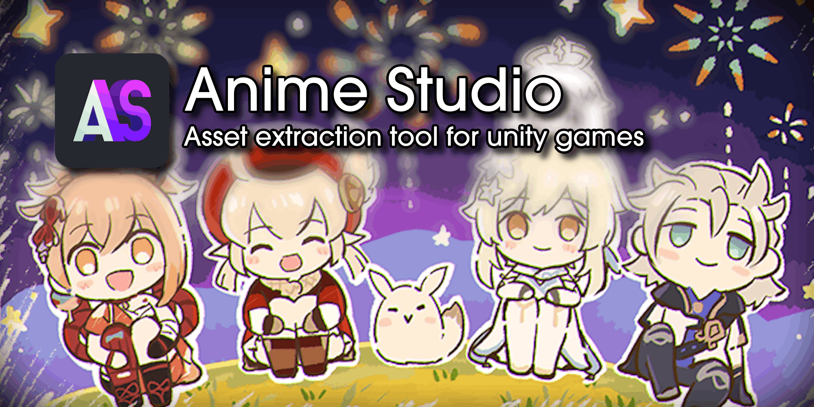

<p align="center">
  
</p>

# AnimeStudio

> 从 Unity 游戏资源包里，把 UI 图片、贴图、模型、动作、音频、着色器拆出来，变成能直接打开的文件。

[](https://dotnet.microsoft.com/download/dotnet)
[](https://dotnet.microsoft.com/download/dotnet)
[](LICENSE)

**[中文说明书](docs/index.html)** · [快速开始](#快速开始) · [用 Host 提取 UI 图片](#用-host-提取-ui-图片) · [命令行](#命令行-cli) · [从源码构建](#从源码构建) · [仓库结构](#仓库结构)

---

## 这是什么

AnimeStudio 打开 Unity 打好的资源包（bundle / CAB），把里面能认出来的东西列成清单：贴图、Sprite、模型、动画、音频、着色器、文本。清单里的东西可以先预览，再导出成 PNG、FBX、WAV、shader 这类别的软件能直接用的文件。

这个仓库是 [Escartem/AnimeStudio](https://github.com/Escartem/AnimeStudio) 的 fork，上游可以一路追到 [Studio](https://github.com/RazTools/Studio) 和 [AssetStudio](https://github.com/Perfare/AssetStudio)。和上游相比，这个 fork 把重心挪到了 **UI 图片提取** 上：

- **新增桌面端 `AnimeStudio.Host`**：一个本地 WebView2 界面，专门做「找游戏 → 建索引 → 逛图库 → 勾选 → 导出 PNG」这条线。它会自动找已安装的星穹铁道和绝区零，图库带缩略图、分类、搜索、分页和跨页多选。
- **索引更快更小**：AssetMap v2 紧凑格式、4 线程并行建图、按文件增量缓存。游戏更新后重建通常只要几秒，不用每次全量扫。
- **范围收窄**：文本表和配置表的专用提取链路已经移除，工具专注于 UI 图片；通用资产导出（贴图、模型、音频、着色器……）照旧保留在 GUI 和 CLI 里。

想看它内部怎么工作、每个游戏用的是什么锁，[中文说明书](docs/index.html) 里有更细的页面。

## 功能一览

| 能力 | 说明 | 在哪用 |
| --- | --- | --- |
| UI 图库 | 只负责预览：160 px 缩略图按需生成、按容器分类、按名称搜索、每页 120 张；大图查看器支持 ← → 翻页、滚轮缩放、1:1、拖拽平移 | Host |
| 筛选导出 | 「资源浏览」按名称、容器、来源查索引，整行勾选（Shift 连选、全选本页），再导出所选或全部匹配 | Host |
| 资源索引 | 建 `AssetMap`（紧凑 v2，只收 `Sprite` + `Texture2D`），并行扫描，只重扫变化的包 | Host / CLI |
| ZZZ 容器路径 | 绝区零的容器是 xxhash64；下载 Eleiyas 的 Z3 索引后显示成 `Assets/NapResources/…` 真实路径，导出也按路径分组 | Host / CLI |
| 资源浏览 | 按名称、容器、来源直接查索引；可把名称或容器条件交给 CLI 导出 | Host |
| 快照对比 | 导出后自动和上一份输出比对：新增、消失、尺寸或文件大小变化的图片 | Host |
| 每游戏独立输出 | 星铁、绝区零各一条输出目录，互不覆盖；文件夹改名后自动跟随 | Host |
| 经典界面 | 全量加载、类型过滤、12 个导出入口、图片 / 音频 / 模型 / 字体 / 文本预览、Asset Browser 双地图对比 | GUI |
| 批量与脚本 | 递归导出、按类型 / 名称 / 容器过滤、建图、按图导出、同名去重 | CLI |
| 通用导出 | PNG / JPG / TGA / HDR、FBX / OBJ、WAV / FSB、shader、字体、JSON / TXT / DAT | 全部 |

## 快速开始

### 从源码构建

需要：

- Windows 10 / 11 x64
- [.NET SDK 10](https://dotnet.microsoft.com/download/dotnet)（`global.json` 固定 10.0.402，允许 `latestFeature`）
- 运行 GUI / Host 还需要 **.NET 10 Desktop Runtime**；Host 另外需要 **WebView2 Evergreen Runtime**（Win11 自带，Win10 一般随 Edge 更新）
- 只有重新编译原生库时才需要 Visual Studio 2022 + C++ 桌面工作负载；仓库已经带了 9 个预编译 DLL（`AnimeStudio.Libraries/`）
- 重新编译 `AnimeStudio.FBXNative` 需要 Autodesk **FBX SDK 2020.3.7**，路径写死在 vcxproj 里

```powershell
git clone https://github.com/a285292107s/AnimeStudio.git
cd AnimeStudio
pwsh -File build.ps1
```

`build.ps1` 会编译 Patcher（`net10.0`）和 CLI / GUI / Host（统一 `net10.0-windows` 单目标），用 Patcher 把 GUI / CLI 的 exe 内嵌路径改到 `bin\`，把产物收进 `dist\`，跑一遍单元测试，并生成两个启动脚本。

```text
dist/
├─ run-host.cmd          # 启动网页界面（推荐）
├─ run-gui.cmd           # 启动经典窗口界面
├─ AnimeStudio.GUI.exe
├─ AnimeStudio.CLI.exe
├─ LICENSE
└─ bin/
   ├─ AnimeStudio.Host.exe
   ├─ wwwroot/           # Host 的 HTML / CSS / JS
   ├─ CNKeys.json
   └─ ...                # 托管与原生 DLL
```

> 根目录的 exe 按相对路径去 `bin\` 找自己的部件，别单独拷走；Host 也会在上一层目录里找 `AnimeStudio.CLI.exe`。

本仓库的工作流没有配置 Release 发布，只提供构建产物：`master` 每次推送都会触发 GitHub Actions 的 Build 工作流，成功的话可以从 [Actions](https://github.com/a285292107s/AnimeStudio/actions) 下载它上传的 `AnimeStudio` 产物；否则就按上面的步骤自己编。

### 三个入口

| 入口 | 适合 |
| --- | --- |
| `dist\run-host.cmd`（或 `dist\bin\AnimeStudio.Host.exe`） | 提取 UI 图片：自动找游戏、建索引、逛图库、勾选导出 |
| `dist\AnimeStudio.GUI.exe` | 经典 WinForms 界面：全量加载、任意类型预览和导出 |
| `dist\AnimeStudio.CLI.exe` | 脚本、批处理、建索引和资源地图 |

## 用 Host 提取 UI 图片

1. **确认游戏目录。** 首次启动会自动从 miHoYo Launcher 的注册表、Program Files 和各盘常见目录里找星穹铁道、绝区零；找不到就点「更换」手动选。首次向导三步走：游戏目录 → 输出目录 → 建索引。
2. **给每款游戏指定输出目录。** 设置里 SR 和 ZZZ 各有一条路径，改一款不影响另一款；切换游戏时图库、索引和快照一起切过去。输出文件夹在资源管理器里改名也没关系，Host 会凭目录里的 `.anime-studio.json` 标记找回来。
3. **重建索引。** 索引写在 `<输出目录>\index\<索引名>.map`（默认 `index\game.map`）。首次几分钟（4 线程），之后只重扫变化的包，通常几秒。索引只记录「哪个资源在哪个 block 里」，不导出文件。
4. **筛选要导出的资源。** 索引里只有贴图（`Sprite` + `Texture2D`），所以「资源浏览」列出来的就是全部候选，可以按名称、容器、来源再收窄，默认只看有路径的那批。整行点一下就是勾选，Shift 连选一段，表头是全选本页；右侧「详情」面板会变成购物车，列出勾中的名称。
5. **导出 PNG。** 点「导出所选 PNG」（单次最多 400 个名称，自动去重），或者用「导出全部匹配」把当前过滤条件直接交给 CLI。导出按容器路径分组，同名资源不会互相覆盖；进度、ETA 和取消都在侧栏与「日志」里。
6. **在图库里看结果。** 「UI 图库」只负责预览：按容器分类、按名称搜索、每页 120 张，缩略图缓存在 `.cache\thumbs`。点任意一张进大图：← → 连着翻（翻到页边界会自动取下一页）、滚轮缩放、双击 1:1、拖拽平移，Esc 退出。缩略图有 S / M / L 三档。
7. **对比变化。** 每次导出结束会自动和上一份快照比对图片的新增、消失和尺寸变化；「设置 → 对比上次快照」可以随时手动重跑。

几个补充：

- 「导出全部匹配」需要至少一个名称或容器条件（来源过滤暂不支持导出），避免把整张地图都导出去。
- **绝区零的容器是哈希。** ZZZ 的 bundle 清单里存的是 xxhash64，没有索引时容器只能显示成一串数字。设置里点「下载」会拉取 [Eleiyas 的 Z3 索引](https://github.com/Eleiyas/Z3-Asset-Index)（约 81 MB，存到 `%LOCALAPPDATA%\AnimeStudio\Maps`），建索引时它会把哈希换成人能看的路径（`Assets/NapResources/UI/…`）直接写进地图，`--containers` 和按容器导出也一起生效；已经建好的哈希地图也不必重建，资源浏览在查询时会顺手还原。图片条目里约 71% 能换出路径，剩下 29% 是上游索引也没收录的哈希——所以资源浏览默认勾着「只看有路径的」，取消勾选才会连这些数字容器和 `resources.assets` 里那些没有容器的内置贴图一起列出来。
- 设置保存在 `%LOCALAPPDATA%\AnimeStudio\host.settings.json`，崩溃日志是同目录的 `host-crash.log`。
- 图库只扫输出目录里的 PNG。Host 不再有文本页，文本表和配置表的专用提取已经从本 fork 移除；通用 `TextAsset` 仍然可以当普通资产导出。
- Host 目前只自动识别星穹铁道和绝区零；其它游戏用 GUI / CLI 的 `--game` 指定。

## 命令行 CLI

```text
AnimeStudio.CLI.exe <input_path> <output_path> --game <GameType>
```

输入可以是单个文件，也可以是目录（递归扫描）。游戏名是 `GameType` 枚举名，比如 `SR`、`GI`、`ZZZ`。两个路径参数和 `--game` 都必填，其余参数见下表。

```powershell
# 导出星铁 UI 目录下的 Sprite 和 Texture2D（--types 用空格分隔，不是逗号）
AnimeStudio.CLI.exe "D:\Games\StarRail\StarRail_Data\StreamingAssets" "D:\out\sr-ui" --game SR --types Sprite Texture2D --names "ui_.*"

# 只建资源地图，不导出资源（紧凑 v2）
AnimeStudio.CLI.exe "D:\Games\StarRail\StarRail_Data\StreamingAssets" "D:\out\sr" --game SR --map_op AssetMap --map_type MessagePack --map_name sr-assets

# 读已有地图，按地图里的条目导出，同名资源只导第一份
AnimeStudio.CLI.exe "D:\Games\StarRail\StarRail_Data\StreamingAssets" "D:\out\sr-ui" --game SR --map_op AssetMap,Load --map_type MessagePack --map_name "D:\out\sr\sr-assets.map" --types Sprite --dedupe_names
```

主要参数：

| 参数 | 取值 | 默认 | 说明 |
| --- | --- | --- | --- |
| `input_path` / `output_path` | 路径 | 必填 | 输入文件或目录；输出目录 |
| `--game` | `GameType` 枚举名 | 必填 | `SR`、`GI`、`ZZZ` 等 |
| `--types` | Unity 类型，空格分隔 | 全部可导出类型 | 可加 `:Parse` / `:Export` / `:Both`，例如 `Texture2D:Export` |
| `--names` / `--containers` | 正则 | 无 | 过滤名称 / 容器；单个参数也可以给正则文件路径 |
| `--dedupe_names` | 开关 | 关 | 同名资源只导第一份 |
| `--export_type` | `Convert` / `Raw` / `Dump` / `JSON` | `Convert` | 转换导出 / 原始字节 / 字段文本 / JSON |
| `--group_assets` | `ByType` / `ByContainer` / `BySource` / `None` | `ByType` | 输出目录布局 |
| `--map_op` | `None` / `AssetMap` / `CABMap` / `Both` / `All`，可叠加 `Load` | `None` | 建图；`AssetMap,Load` 表示读图并按图导出 |
| `--map_type` | `MessagePack` / `XML` / `JSON` | `XML` | 建图格式；`MessagePack` 就是紧凑 v2 的 `.map`，Host 用这个 |
| `--map_name` | 名称或路径 | `assets_map` | 地图文件名 / 读取路径 |
| `--threads` | 整数 | `4` | 建图并行线程数，`1` 为顺序 |
| `--map_full` | 开关 | 关 | 忽略增量缓存，全量重扫 |
| `--no_hash` | 开关 | 关 | 建图时跳过逐个资源哈希，更快更小 |
| `--silent` / `--logger_flags` | 开关 / 事件列表 | 关 / 常规日志 | 安静模式 / 控制日志事件 |
| `--unity_version` | 字符串 | 自动 | 覆盖 Unity 版本 |
| `--key` | 字节 | 无 | MiHoYoBinData 的 XOR 密钥 |
| `--ai_file` / `--dummy_dlls` | 路径 | 无 | GI 容器索引 / DummyDll 目录 |

行为说明：

- 导出目标目录里已存在的同名文件会被跳过，不覆盖。
- 退出码：`0` 成功，`1` 游戏名无效，`2` 运行异常，`3` 建图失败。
- `.map` 现在只有紧凑 v2 一种布局（文件头 `ASM2`），旧的 v1 MessagePack 地图不再读；读到旧图会提示重新建索引。`--container_index` 可以让绝区零的容器在**查询时**显示成真实路径，不用重建地图。
- 建图增量缓存位于 `<输出目录>\.cache\<地图名>[.过滤指纹].mapcache\`，每个过滤组合一个目录；加 `--map_full` 会忽略它。

## 经典 GUI

`AnimeStudio.GUI.exe` 是上游那套 WinForms 界面，功能没删：File 菜单载入文件或文件夹、把包原样导出、Reset / Abort；三段式 Select Game；按类型过滤；12 个导出入口（All / Selected / Filtered × Convert / Raw / Dump / JSON）；图片、音频、模型、字体、文本预览；以及 Asset Browser 的地图浏览、relocate 和双地图对比。

它适合导模型、音频，或者不看索引直接翻整个包。代价是加载时全量进内存，大目录会很慢——只找 UI 图片的话，Host 的索引加图库更省事。

## 游戏支持

- **Host**：自动识别并索引星穹铁道（SR）和绝区零（ZZZ）。
- **GUI / CLI**：内置七十多个游戏和版本条目（含各 CBT 版本），覆盖 Hoyo 系（原神、星铁、绝区零、崩坏3 等）、`CNKeys.json` 里的 24 条 UnityCN 密钥，以及一批常见的加密游戏和普通 Unity 游戏。完整的枚举名见 [`GameManager.LoadGames`](AnimeStudio/GameManager.cs)，GUI 的 Select Game 也列出了全部条目。

选游戏是唯一一个「选错就全盘皆错」的步骤：不同游戏用不同的锁和钥匙，拿错钥匙轻则列表空白，重则导出一堆乱码或打不开的文件。先确定厂商，再确定版本。

工具只读游戏文件，导出到你指定的输出目录。唯一的例外是分片包：碎片会被合并成一个完整文件写回碎片所在的目录。

## 仓库结构

| 项目 | 语言 | 作用 |
| --- | --- | --- |
| `AnimeStudio` | C# | 核心：容器解析、SerializedFile、对象模型、贴图解码、AssetMap、加密 |
| `AnimeStudio.Application` | C# | 无 UI 的应用层：安装检测、图片快照 diff |
| `AnimeStudio.Utility` | C# | 导出工具：ACL 动画、shader、音频 |
| `AnimeStudio.GUI` | C# / WinForms | 经典图形界面 |
| `AnimeStudio.CLI` | C# | 命令行入口 |
| `AnimeStudio.Host` | C# + WebView2 | 新桌面端宿主；界面在 `wwwroot/`（HTML / CSS / JS） |
| `AnimeStudio.Tests` | C# | 零依赖测试：安装检测 + 快照 diff，15 项检查 |
| `AnimeStudio.Patcher` | C# | 构建期改写 apphost 内嵌的 DLL 路径 |
| `AnimeStudio.PInvoke` / `AnimeStudio.FBXWrapper` | C# | 原生库加载 / FBX 托管封装 |
| `AnimeStudio.Ooz`、`AnimeStudio.FBXNative`、`AnimeStudio.HLSLDecompiler`、`AnimeStudio.ACL.*` | C++ | Oodle 解压、FBX 导出、DXBC → HLSL、ACL 动画解压 |

原生库的 DLL 已经预编译在 `AnimeStudio.Libraries/`，随仓库一起提交；只有改它们的源码才需要重新编译。`AnimeStudio.Ooz` 和 `AnimeStudio.FBXNative` 不随 solution 构建，其余原生项目会跟着编。

## 开发与文档

```powershell
# 日常改托管代码
dotnet build AnimeStudio.GUI

# 完整构建：出 dist、跑测试
pwsh -File build.ps1

# 只跑测试（不需要游戏数据）
dotnet run --project AnimeStudio.Tests -c Release
```

- 测试覆盖安装检测和图片快照 diff，共 15 项。
- 原生库需要 Visual Studio 的 C++ 桌面工作负载；`AnimeStudio.FBXNative` 还要 FBX SDK 2020.3.7。
- 想加游戏，通常要动四处：`GameType` 枚举、`IsXxx` 谓词、`LoadGames` 注册、密钥 record。细节见 [想改代码](docs/dev.html)。
- 中文说明书在 [`docs/`](docs/index.html)：[五分钟上手](docs/start.html)、[界面导览](docs/gui.html)、[它怎么工作](docs/pipeline.html)、[游戏与它们的锁](docs/games.html)、[批量与资产地图](docs/batch.html)、[想改代码](docs/dev.html)、[疑难解答](docs/faq.html)。直接用浏览器打开 `docs/index.html` 即可，不需要起服务器。
- 说明书里的个别段落可能落后于当前代码（比如文本提取已经移除），不一致时以代码和本 README 为准。

## 致谢

这个项目的根在 [AssetStudio](https://github.com/Perfare/AssetStudio)（Perfare），后来有 [Studio](https://github.com/RazTools/Studio)（Razmoth），再到 [AnimeStudio](https://github.com/Escartem/AnimeStudio)（Escartem）。这个 fork 站在它们上面。

原生侧用的是别人的工作：

- [ooz](https://github.com/powzix/ooz)（powzix，经 [zao 的 fork](https://github.com/zao/ooz)）—— Kraken 解压
- [FBX SDK](https://aps.autodesk.com/developer/overview/fbx-sdk)（Autodesk），wrapper 基于 Perfare 和 hozuki 的版本 —— FBX 导出
- [3Dmigoto](https://github.com/bo3b/3Dmigoto) 和 [HLSLcc](https://github.com/Unity-Technologies/HLSLcc)（Unity）—— 着色器反编译
- [ACL](https://github.com/nfrechette/acl) 和 [RTM](https://github.com/nfrechette/rtm)（Nicholas Frechette），wrapper 由 Razmoth 维护 —— 动画解压
- [FMOD Engine](https://www.fmod.com/)（Firelight Technologies）—— 音频预览与导出

上游 wiki 和教程仍然适用于通用 GUI / CLI：[AnimeStudio wiki](https://github.com/Escartem/AnimeStudio/wiki)、[Modder4869 的入门教程](https://gist.github.com/Modder4869/0f5371f8879607eb95b8e63badca227e)。也欢迎来[上游 Discord](https://discord.gg/fzRdtVh) 提问。

## 许可

仓库整体是 [MIT](LICENSE)，但分发前请留意混合许可：

- `AnimeStudio.Ooz/kraken.cpp` 带 GPLv3 头
- FMOD 的免费许可是**非商业用途**
- FBX SDK 受 Autodesk 条款约束

商业或闭源分发前，请逐项核对。这个 fork 不是 Escartem 的官方发布，也不代表上游立场。

## 贡献

欢迎 PR：新游戏、解析修复、导出补全、Host 改进都行。改之前可以看一眼 [想改代码](docs/dev.html)，那里列了加游戏、加导出格式、加容器和加密的锚点。

这个 fork 主要服务于 UI 图片工作流；如果是通用功能改进，也可以同时提给[上游](https://github.com/Escartem/AnimeStudio)。

---

## 贡献者 ✨

感谢这些贡献者：

<!-- ALL-CONTRIBUTORS-LIST:START - Do not remove or modify this section -->
<!-- prettier-ignore-start -->
<!-- markdownlint-disable -->
<table>
  <tbody>
    <tr>
      <td align="center" valign="top" width="14.28%"><a href="https://github.com/hrothgar234567"><br /><sub><b>hrothgar234567</b></sub></a><br /><a href="https://github.com/Escartem/AnimeStudio/commits?author=hrothgar234567" title="Code">💻</a> <a href="https://github.com/Escartem/AnimeStudio/pulls?q=is%3Apr+reviewed-by%3Ahrothgar234567" title="Reviewed Pull Requests">👀</a> <a href="#ideas-hrothgar234567" title="Ideas, Planning, & Feedback">🤔</a> <a href="#question-hrothgar234567" title="Answering Questions">💬</a> <a href="#platform-hrothgar234567" title="Packaging/porting to new platform">📦</a> <a href="#security-hrothgar234567" title="Security">🛡️</a></td>
      <td align="center" valign="top" width="14.28%"><a href="https://soundcloud.com/eleiyas/"><br /><sub><b>Elliot Bastiani</b></sub></a><br /><a href="https://github.com/Escartem/AnimeStudio/commits?author=Eleiyas" title="Code">💻</a> <a href="#ideas-Eleiyas" title="Ideas, Planning, & Feedback">🤔</a></td>
      <td align="center" valign="top" width="14.28%"><a href="https://github.com/yarik0chka"><br /><sub><b>yarik0chka</b></sub></a><br /><a href="https://github.com/Escartem/AnimeStudio/commits?author=yarik0chka" title="Code">💻</a> <a href="https://github.com/Escartem/AnimeStudio/issues?q=author%3Ayarik0chka" title="Bug reports">🐛</a> <a href="#question-yarik0chka" title="Answering Questions">💬</a></td>
      <td align="center" valign="top" width="14.28%"><a href="https://www.youtube.com/c/Manashiku"><br /><sub><b>manashiku</b></sub></a><br /><a href="https://github.com/Escartem/AnimeStudio/commits?author=Manashiku" title="Code">💻</a> <a href="https://github.com/Escartem/AnimeStudio/issues?q=author%3AManashiku" title="Bug reports">🐛</a></td>
      <td align="center" valign="top" width="14.28%"><a href="https://github.com/Razmoth"><br /><sub><b>Razmoth</b></sub></a><br /><a href="https://github.com/Escartem/AnimeStudio/commits?author=Razmoth" title="Code">💻</a> <a href="https://github.com/Escartem/AnimeStudio/issues?q=author%3ARazmoth" title="Bug reports">🐛</a> <a href="#ideas-Razmoth" title="Ideas, Planning, & Feedback">🤔</a> <a href="#research-Razmoth" title="Research">🔬</a></td>
      <td align="center" valign="top" width="14.28%"><a href="https://github.com/Dimbreath"><br /><sub><b>Dimbreath</b></sub></a><br /><a href="https://github.com/Escartem/AnimeStudio/issues?q=author%3ADimbreath" title="Bug reports">🐛</a></td>
      <td align="center" valign="top" width="14.28%"><a href="https://github.com/LukeFZ"><br /><sub><b>Luke</b></sub></a><br /><a href="https://github.com/Escartem/AnimeStudio/issues?q=author%3ALukeFZ" title="Bug reports">🐛</a> <a href="#security-LukeFZ" title="Security">🛡️</a></td>
    </tr>
    <tr>
      <td align="center" valign="top" width="14.28%"><a href="https://github.com/aelurum"><br /><sub><b>VaDiM</b></sub></a><br /><a href="https://github.com/Escartem/AnimeStudio/commits?author=aelurum" title="Code">💻</a></td>
      <td align="center" valign="top" width="14.28%"><a href="https://festivity.moe/"><br /><sub><b>festivity</b></sub></a><br /><a href="https://github.com/Escartem/AnimeStudio/commits?author=festivities" title="Code">💻</a></td>
      <td align="center" valign="top" width="14.28%"><a href="https://github.com/MiemieMethod"><br /><sub><b>方法放寒假</b></sub></a><br /><a href="https://github.com/Escartem/AnimeStudio/commits?author=MiemieMethod" title="Code">💻</a> <a href="#platform-MiemieMethod" title="Packaging/porting to new platform">📦</a></td>
      <td align="center" valign="top" width="14.28%"><a href="https://github.com/jokelbaf"><br /><sub><b>JokelBaf</b></sub></a><br /><a href="https://github.com/Escartem/AnimeStudio/commits?author=jokelbaf" title="Code">💻</a></td>
      <td align="center" valign="top" width="14.28%"><a href="https://github.com/formagGinoo"><br /><sub><b>formagGino</b></sub></a><br /><a href="https://github.com/Escartem/AnimeStudio/commits?author=formagGinoo" title="Code">💻</a> <a href="#platform-formagGinoo" title="Packaging/porting to new platform">📦</a></td>
      <td align="center" valign="top" width="14.28%"><a href="https://github.com/hashblen"><br /><sub><b>Hashblen</b></sub></a><br /><a href="https://github.com/Escartem/AnimeStudio/issues?q=author%3Ahashblen" title="Bug reports">🐛</a> <a href="https://github.com/Escartem/AnimeStudio/commits?author=hashblen" title="Code">💻</a></td>
      <td align="center" valign="top" width="14.28%"><a href="https://github.com/Sieluna"><br /><sub><b>Sieluna</b></sub></a><br /><a href="https://github.com/Escartem/AnimeStudio/commits?author=Sieluna" title="Code">💻</a> <a href="#infra-Sieluna" title="Infrastructure (Hosting, Build-Tools, etc)">🚇</a></td>
    </tr>
    <tr>
      <td align="center" valign="top" width="14.28%"><a href="https://github.com/1004452714"><br /><sub><b>DarkFlameMaster</b></sub></a><br /><a href="https://github.com/Escartem/AnimeStudio/issues?q=author%3A1004452714" title="Bug reports">🐛</a></td>
      <td align="center" valign="top" width="14.28%"><a href="https://github.com/SherkeyXD"><br /><sub><b>SherkeyXD</b></sub></a><br /><a href="https://github.com/Escartem/AnimeStudio/commits?author=SherkeyXD" title="Code">💻</a> <a href="https://github.com/Escartem/AnimeStudio/issues?q=author%3ASherkeyXD" title="Bug reports">🐛</a></td>
      <td align="center" valign="top" width="14.28%"><a href="https://github.com/djpadbit"><br /><sub><b>djpadbit</b></sub></a><br /><a href="https://github.com/Escartem/AnimeStudio/commits?author=djpadbit" title="Code">💻</a> <a href="#platform-djpadbit" title="Packaging/porting to new platform">📦</a></td>
      <td align="center" valign="top" width="14.28%"><a href="https://github.com/tserj"><br /><sub><b>tserj</b></sub></a><br /><a href="https://github.com/Escartem/AnimeStudio/issues?q=author%3Atserj" title="Bug reports">🐛</a></td>
      <td align="center" valign="top" width="14.28%"><a href="http://momokko.moe"><br /><sub><b>綾瀬桃桃</b></sub></a><br /><a href="https://github.com/Escartem/AnimeStudio/issues?q=author%3AMomoko-Ayase" title="Bug reports">🐛</a> <a href="https://github.com/Escartem/AnimeStudio/commits?author=Momoko-Ayase" title="Code">💻</a></td>
      <td align="center" valign="top" width="14.28%"><a href="https://github.com/bbdd2729"><br /><sub><b>bbdd</b></sub></a><br /><a href="https://github.com/Escartem/AnimeStudio/commits?author=bbdd2729" title="Code">💻</a></td>
      <td align="center" valign="top" width="14.28%"><a href="https://github.com/ihzgniqgnem"><br /><sub><b>ihzgniqgnem</b></sub></a><br /><a href="https://github.com/Escartem/AnimeStudio/issues?q=author%3Aihzgniqgnem" title="Bug reports">🐛</a> <a href="https://github.com/Escartem/AnimeStudio/commits?author=ihzgniqgnem" title="Code">💻</a></td>
    </tr>
    <tr>
      <td align="center" valign="top" width="14.28%"><a href="https://github.com/Koko-boya"><br /><sub><b>Koks</b></sub></a><br /><a href="https://github.com/Escartem/AnimeStudio/commits?author=Koko-boya" title="Code">💻</a></td>
      <td align="center" valign="top" width="14.28%"><a href="https://github.com/xiaoding521234"><br /><sub><b>xiaoding521234</b></sub></a><br /><a href="https://github.com/Escartem/AnimeStudio/commits?author=xiaoding521234" title="Code">💻</a> <a href="https://github.com/Escartem/AnimeStudio/issues?q=author%3Axiaoding521234" title="Bug reports">🐛</a></td>
    </tr>
  </tbody>
</table>

<!-- markdownlint-restore -->
<!-- prettier-ignore-end -->

<!-- ALL-CONTRIBUTORS-LIST:END -->

贡献不分形式，都欢迎。
